# NXP Application Code Hub

## Time Series Studio powered, on-device learning Fan anomaly detection based on FRDM-MCXA156

An application designed for monitoring the status of a fan, or other vibration source, which utilizes an accelerometer sensor attached to the fan to check if the fan is operating in a normal condition.

Application runs on a FRDM-MCXA156 with 96MHz Cortex-M33, 1M Flash and 128KB SRAM. 

The Application is powered by an IKM (Incremental KMeans for anomaly detection) model, which was trained and generated by [eIQ Time Series Studio](https://www.nxp.com/products/processors-and-microcontrollers/arm-microcontrollers/eiq-time-series-studio-for-edge-ai-development:eIQ-TSS). The model supports on-device learning as well.

Model size is 7 KB and only uses 4KB of RAM. Model inference time is 6ms. 

For details on how the model was trained, please refer to [AN14549](https://www.nxp.com/docs/en/application-note/AN14549.pdf)

A block diagram of the system and software workflow are below:

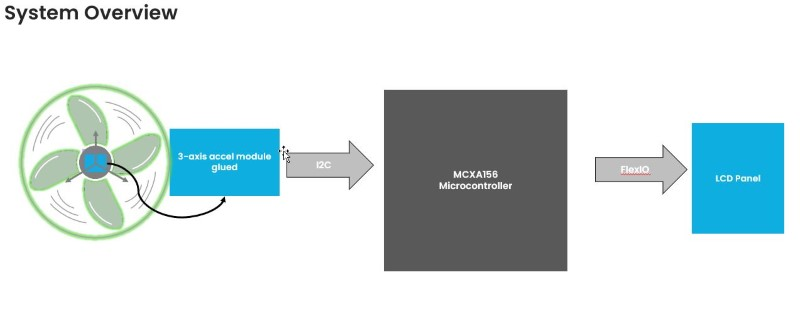

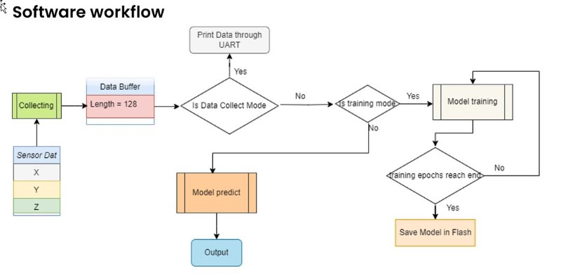

#### Board: FRDM-MCXA156

#### Categories: AI/ML, Anomaly Detection

#### Peripherals: DISPLAY, I2C

#### Toolchains: MCUXpresso IDE, VS Code

## Table of Contents

1. [Software](#step1)
2. [Hardware](#step2)
3. [Setup](#step3)
4. [Results](#step4)
5. [FAQs](#step5) 
6. [Support](#step6)
7. [Release Notes](#step7)

## 1. Software

- Download [MCUXpresso SDK for_FRDM-MCXA156](https://mcuxpresso.nxp.com/builder?hw=FRDM-MCXA156)
- Download a supported IDE: 
  - [MCUXpresso IDE V11.9.0 or later](https://www.nxp.com/design/design-center/software/development-software/mcuxpresso-software-and-tools-/mcuxpresso-integrated-development-environment-ide:MCUXpresso-IDE).
  - [MCUXpresso for Visual Studio Code](https://www.nxp.com/design/training/getting-started-with-mcuxpresso-for-visual-studio-code:TIP-GETTING-STARTED-WITH-MCUXPRESSO-FOR-VS-CODE) 

- Download and install [eIQ Time Series Studio](https://www.nxp.com/products/processors-and-microcontrollers/arm-microcontrollers/eiq-time-series-studio-for-edge-ai-development:eIQ-TSS) (not needed to run the example but it is how the model was created)

## 2. Hardware

- [FRDM-MCXA156](https://www.nxp.com/part/FRDM-MCXA156)
- [LCD-PAR-S035](https://www.nxp.com/design/design-center/development-boards-and-designs/general-purpose-mcus/3-5-480x320-ips-tft-lcd-module:LCD-PAR-S035)
- Accelerometer:
  - [6DOF-IMU-20-Click](https://www.mikroe.com/6dof-imu-20-click) (Recommended and default for project) or
  - [ACCEL-4-CLICK](https://www.mikroe.com/accel-4-click)

- Fan or vibration source
- Type-C USB cable

## 3. Setup

### 3.1 Step 1

- Plug in LCD-PAR-S035 LCD into the FRDM-MCXA156 (J8)
  
  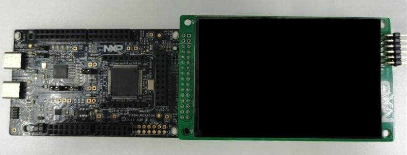

- Mount 6DOF-IMU-20-Click or ACCEL-4-CLICK board to the FAN with sticky tape
  
  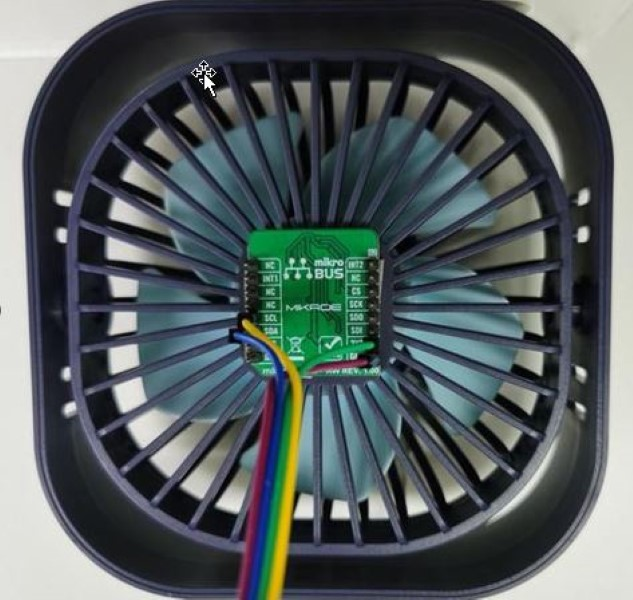

- Use jumper wires to connect FRDM-MCXA156 to the 6DOF-IMU-20-Click or ACCEL-4-CLICK
  
  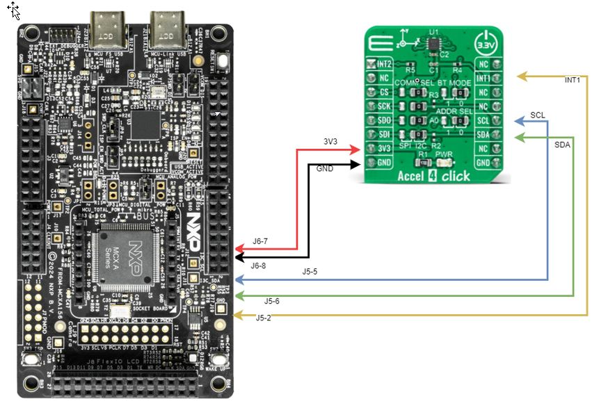

- Connect a USB-C cable to the debug port
  
  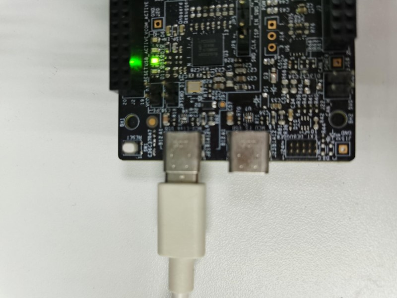

- Completed System
  
  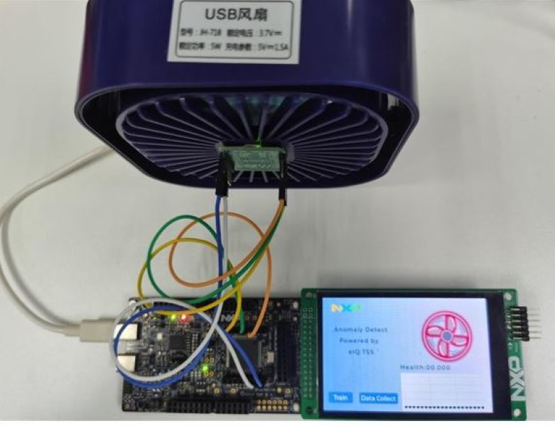

### 3.2 Step 2

Import "dm-tss-powered-on-device-learning-fan-anomaly-based-on-mcxa156" from Application Code Hub

- Import project in MCUXpresso IDE
  
  

- Import project in VS code
  
  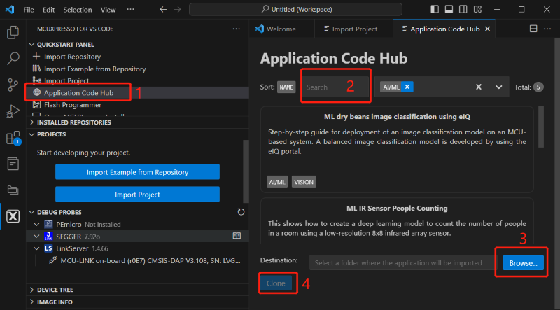

- Select IMU sensor in **sensors/accel_sensor.h** (default IMU is Bosch BMI323 on the 6DOF-IMU-20-CLICK)

    `/*! @brief Selector value for the FXLS8974CF (ACCEL-4-CLICK). */`
    
    `#define ACCEL_SENSOR_FXLS8974 (1)`

    `/*! @brief Selector value for the Bosch BMI323 (6DOF-IMU-20-CLICK). */`

    `#define ACCEL_SENSOR_BMI323 (2)`

    `#ifndef ACCEL_SENSOR_SELECT`

    `#define ACCEL_SENSOR_SELECT ACCEL_SENSOR_BMI323`

    `#endif`

- Build project and download to the board

  - **Notice: please erase the whole flash before download the firmware**
- Open serial terminal for 230400 baud (optional)

## 4. Results

### Training on Device

- Turn on the fan to the desired speed that should be considered "Normal"

- Enter Trainer screen and click the Start button to begin training. Ensure that you do not move the fan during the training procedure. If first time training set the "Train from beginning" option. 
  
  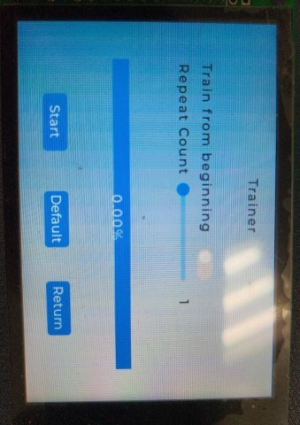

- Return to main after training is complete and it should recognize that fan speed as "Healthy". If need by try training again but leave off the "Train from beginning" option. 
  
  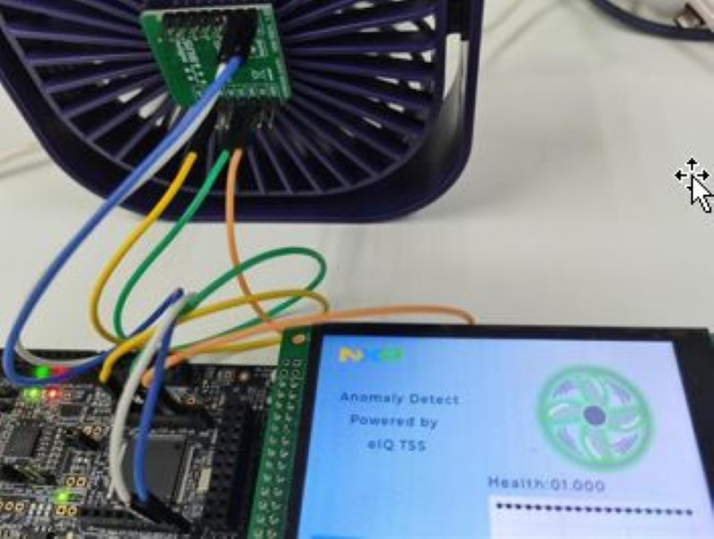

### Testing 
- If fan changes speeds then will get anomaly. But if set back to original fan speed it was trained on, then will read "Healthy" 
  
  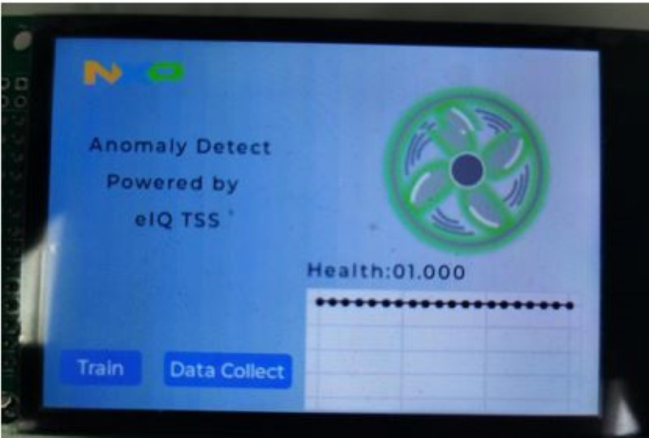

- If knock on the fan, an anomaly will be detected
  
  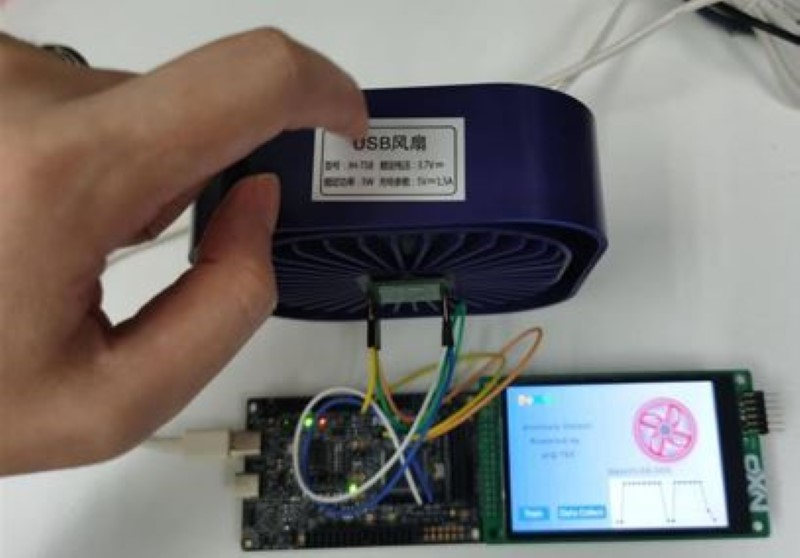

- If insert an object into the fan blades, an anomaly will be detected
  
  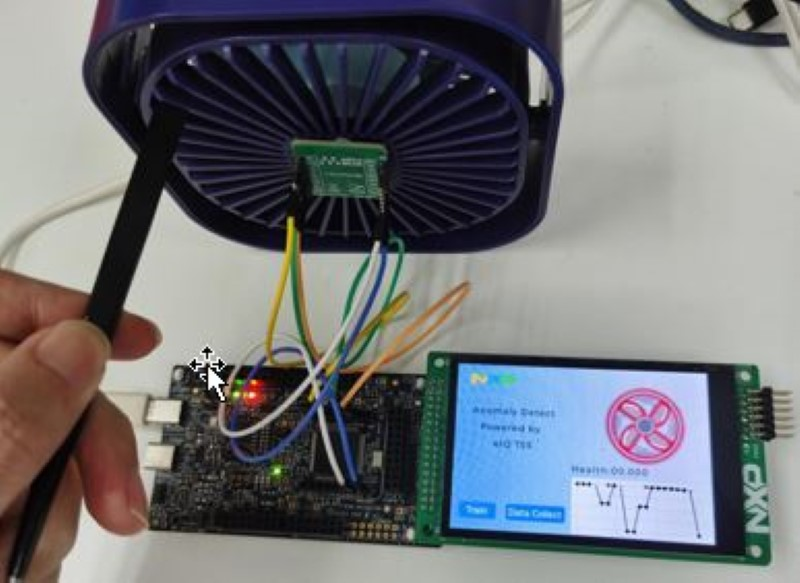

- If modify the angle of the accelerometer by rotating the fan by 90 degrees, an anomaly will be detected.
  
  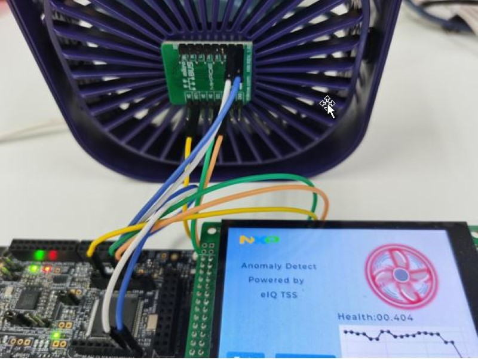

## 5. FAQs

## 6. Support

#### Project Metadata

<!----- Boards ----->

<!----- Categories ----->

<!----- Peripherals ----->

<!----- Toolchains ----->

Questions regarding the content/correctness of this example can be entered as Issues within this GitHub repository.

> **Warning**: For more general technical questions regarding NXP Microcontrollers and the difference in expected functionality, enter your questions on the [NXP Community Forum](https://community.nxp.com/)

## 7. Release Notes

| Version | Description / Update                    | Date                          |
|:-------:| --------------------------------------- | -----------------------------:|
| 1.0     | Initial release on Application Code Hub | November 27th 2024 |
| 1.1     | Update to V1.1                          | August 18th 2025   |
| 1.2     | Update to V1.2                          | November 2th 2026  |

## Licensing

LA_OPT_NXP_Software_License v58

